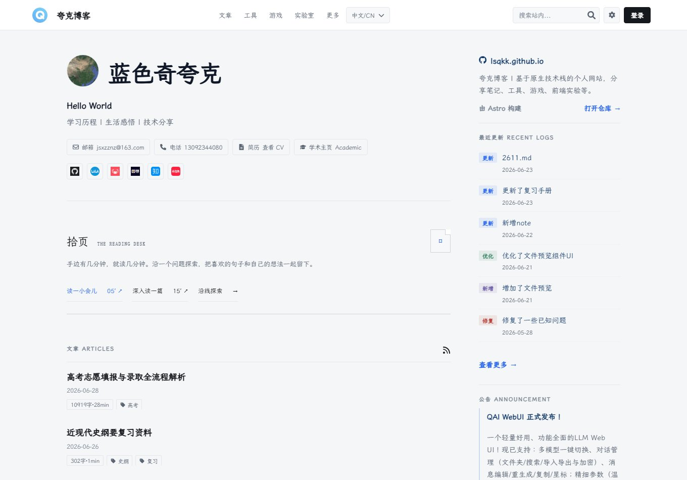
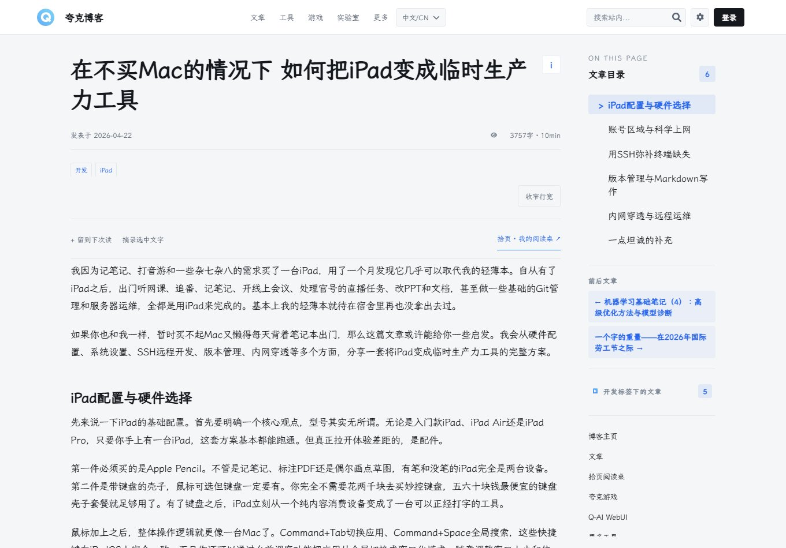
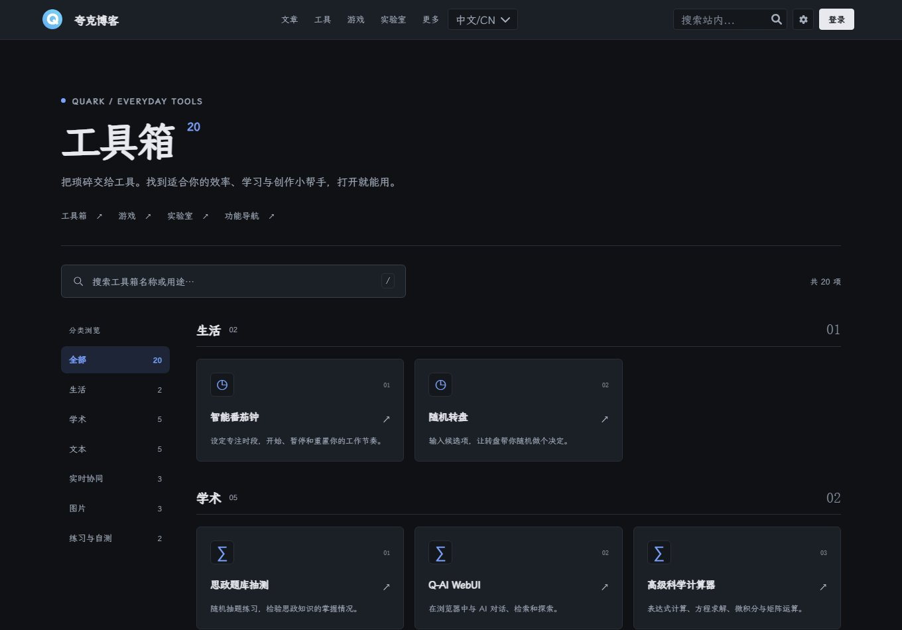
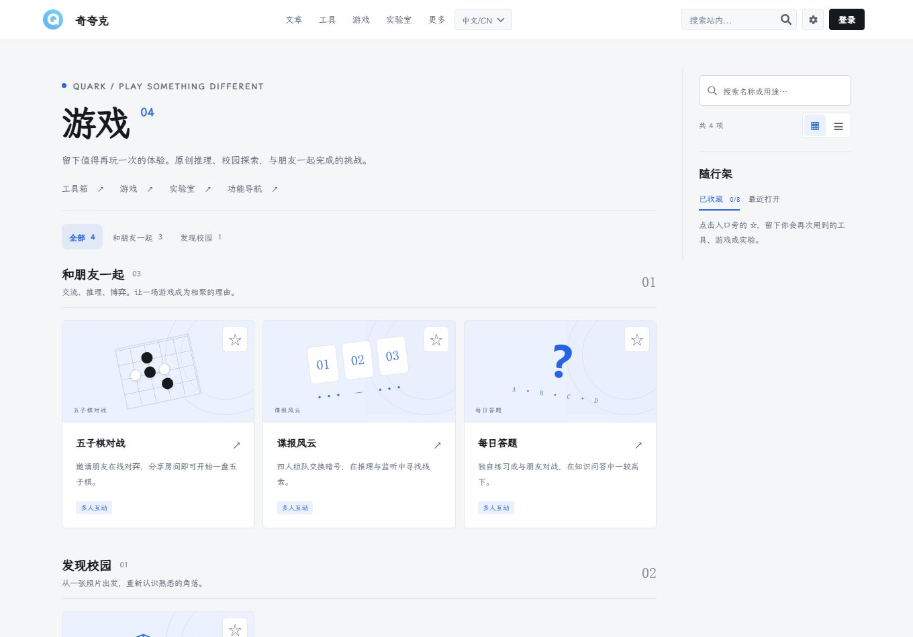

# 奇夸克 · Strange Quark

蓝色奇夸克的个人网站，记录学习、生活与思考，也放着一些可以直接使用的工具、多人游戏和前端实验。

[访问网站](https://lsqkk.github.io/) · [文章](https://lsqkk.github.io/posts/) · [工具](https://lsqkk.github.io/tool/) · [游戏](https://lsqkk.github.io/games/) · [实验室](https://lsqkk.github.io/a/) · [RSS](https://lsqkk.github.io/posts/rss.xml)

## DEMO

下图为仓库构建后的真实页面截图。桌面与手机使用同一套响应式布局，颜色跟随系统深浅主题。预览运行后可用 `npm run demo:capture` 重新生成截图，地址由 `BASE_URL` 指定。

| 首页 | 文章阅读 |
| --- | --- |
|  |  |

| 工具目录 | 游戏目录 |
| --- | --- |
|  |  |

## 网站里有什么

- **阅读与记录**：Markdown 文章、标签与专栏、全文搜索、RSS、目录、代码与公式，以及按时间选读、主题路线、待读清单和私人摘录。
- **生活与交流**：动态、图片画廊、留言、友链、账号中心与用户主页。
- **工具**：权衡决策实验室、Markdown 编辑与导出、图片处理、科学计算、参考文献、OCR、语音识别、打字练习、番茄钟、文件闪传和 PPT 遥控。
- **游戏**：五子棋、谍报风云、每日答题和交大校园图寻。
- **实验室**：校园全景、地图、物理可视化、WebRTC 通信与 AI 交互等项目。

界面以实色表面、细分隔线和留白组织内容。页面结构与正文由 Astro 输出，交互主要使用原生 JavaScript；字体、语言和动态效果可在站内设置中调整。联网功能需要相应服务配置，其可用性不等同于静态页面构建成功。

目录支持卡片与紧凑列表，通过“随行架”在工具、游戏、实验室和首页之间保留常用入口。[权衡](src/docs/页面和功能/权衡决策实验室.md)支持加权比较、贡献拆解和偏好沙盘，草稿保存在浏览器，可导出 JSON 与 Markdown。

顶栏搜索支持 Ctrl/⌘ + K，可按任务查找工具、最近阅读和随行架入口。完整搜索页和 QuarkBot 共用站内索引，文章与动态的正文索引按需加载。OCR 结果、拾页所选摘录和 QuarkBot 回复可通过当前标签页送到 Markdown，预览确认后继续编辑或定制导出。

## 本地运行

使用 Node.js 22.12+ 与 npm。Python CLI 是可选维护工具，浏览和构建静态站点不要求安装 Python。

~~~sh
npm ci
npm run build
npm run preview
~~~

打开终端打印的 Local 地址，默认是 `http://localhost:4321`。端口占用时以实际输出为准。

开发时运行 `npm run dev`；首次启动或修改静态资源、JSON 配置后，先执行 `npm run sync:public` 和 `npm run gen:fa-icons`。Astro 路由和模板支持热更新，`assets/` 中的资源通过同步步骤提供给浏览器。生产验收使用 `build + preview`。

可选的 Quark CLI：

~~~sh
python -m venv .venv
# 激活当前终端对应的虚拟环境后：
python -m pip install -r requirements.txt
python -m pip install -e .
quark --help
~~~

`quark serve` 默认构建后预览；`quark serve --dev` 启动开发服务器；`quark web` 打开本地配置面板。文章创建、日志整理和图片上传等命令见 [维护文档](src/docs/README.md)。

## 架构与部署

~~~text
Markdown / JSON / Astro / assets
              │
        npm run build
              │
             dist ──────────── GitHub Pages
                                  │
                       按页面需要请求 API
                                  │
                         Vercel / Firebase
~~~

- **静态站点**：Astro 5、Markdown 内容集合、原生 JS/CSS；GitHub Actions 构建 `dist/` 并部署到 GitHub Pages。
- **动态 API**：根目录 `api/` 中的 Vercel Serverless 函数，提供配置注入、OAuth、邮件验证、数据库代理和上传签名等。
- **数据与通信**：Firebase RTDB 支撑评论、协同与实时房间；部分通信使用 WebRTC；文件上传使用 Cloudflare R2。
- **本地数据**：阅读清单、私人摘录及部分工具状态存于浏览器，换设备前需要备份。
- **构建优化**：本地图标提取、CSS/JS 压缩、搜索索引、RSS、sitemap 与产物校验。

迁移自己的站点需要更换站点身份、API 地址、来源白名单及启用功能所需的服务配置。仅运行静态构建不会自动配置在线服务。详见 [部署说明](src/docs/迁移部署说明.md) 与 [API 文档](src/docs/API/README.md)。

## 源码与配置

| 位置 | 用途 |
| --- | --- |
| `src/pages/`、`src/layouts/`、`src/components/` | 路由、布局与组件 |
| `posts/` | 文章源码；`posts.json`、`rss.xml` 由脚本生成 |
| `assets/` | 静态资源、页面脚本、公开数据和附件 |
| `src/config/json/` | 导航、首页、字体、API 地址与展示开关 |
| `src/config/reading-paths.json` | 阅读路线 |
| `src/config/retired-pages.json` | 下线页面与兼容跳转 |
| `api/` | 动态 API 源码 |
| `scripts/`、`quark/` | 构建检查与维护工具 |
| `src/docs/` | 架构、功能与维护说明 |
| `docs/demo/` | README 截图，不复制到网站资源目录 |

`public/`、`dist/`、`.quark-artifact/` 是生成目录，不直接编辑。私有凭据和本地资料放在已忽略的 `private/` 或环境变量中。

## 验证

~~~sh
npm run check:syntax
npm run check:docs
npm run test:sitemap
npm run test:desk
npm run test:decision
npm run test:spy-signal
npm run build
~~~

UI 测试需要可解析的 Playwright 和已安装的 Chromium。先启动生产预览，再在另一个终端运行：

~~~sh
npm run test:ui
npm run test:ui:polish
npm run test:ui:desk
npm run test:ui:followup
npm run test:ui:decision
npm run test:ui:layout
~~~

默认测试地址为 `http://127.0.0.1:4321`，可以通过 `BASE_URL` 环境变量指定预览地址。截图写入已忽略的 `test-results/`。布局用例会隔离外部服务，不能替代认证、云端数据库或音视频服务的集成验收。

`npm run typecheck` 检查 `jsconfig.json` 声明的渐进类型范围，目前仍有历史诊断；处理方式见 [类型说明](src/docs/TypeScript规范说明.md)。

## 许可与联系

站点代码采用仓库 [LICENSE](LICENSE) 中的 **GNU Affero General Public License v3.0（AGPLv3）**。文章默认采用 **CC BY-NC-SA 4.0**，单篇另有说明时以该说明为准。第三方库、字体、图片和其他引用资料保留各自的权利与许可，不因包含在仓库中而重新授权。

[关于本站与版权](https://lsqkk.github.io/posts/copyright) · [提交问题](https://github.com/lsqkk/lsqkk.github.io/issues) · [联系站主](mailto:jsxzznz@163.com)
